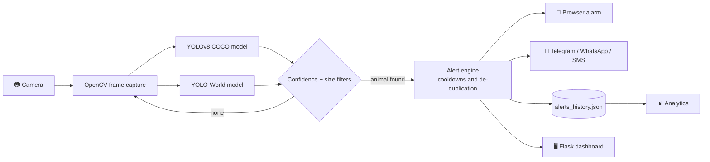

# Wild-Animal-Detection-Project
AI-powered Wild Animal Detection System using Python, YOLOv8, OpenCV, and Deep Learning to detect wild animals in real time, generate instant alert notifications, and manage citizen complaints through a web-based platform.
<div align="center">

# 🐾 Wild AI Detection

### AI-Based Wild Animal Detection and Alert Generation System

Real-time wildlife detection with a live web dashboard, user login, instant alarm and phone alerts, built to reduce human-wildlife conflict in farms, villages and forest-border areas.


[🎥 Demo Video](#-demo) · [✨ Features](#-features) · [🚀 Quick Start](#-quick-start) · [🏗️ How It Works](#️-how-it-works)

</div>

---

## 📌 Problem Statement

In rural and forest-border areas, wild animals such as elephants, leopards and tigers regularly enter farms and villages. This causes crop loss, injuries and fatal conflicts, and people usually find out **after** the animal has arrived.

**Wild AI Detection** watches a live camera feed, identifies dangerous animals with computer vision, and warns people within seconds through an on-screen alarm and a notification on their phone.

---

## 🎥 Demo

> 📺 **Demo video:** _add your YouTube / Google Drive link here_

| Live Dashboard | Alerts & History |
|:---:|:---:|
|  |  |

| Analytics | Phone Notification |
|:---:|:---:|
|  |  |

---

## ✨ Features

| | Feature | Details |
|---|---|---|
| 🎯 | **Real-time detection** | Live webcam stream with bounding boxes, labels and confidence scores |
| 🧠 | **Dual-model AI** | YOLOv8 (COCO) for common large animals plus YOLO-World for open-vocabulary detection of more species |
| 🚨 | **Instant alarm** | Browser siren and a red DANGER status the moment an animal is detected |
| 📱 | **Phone alerts** | Telegram bot alerts with your own message text; optional Twilio WhatsApp and SMS support |
| 🤖 | **Safety assistant** | Chatbot and per-animal safety tips (for example: what to do if an elephant or bear is nearby) |
| 📊 | **Analytics** | Charts of detections per animal and over time |
| 📝 | **Alert history** | Every alert is saved with animal, location, time and status; operators can mark alerts as **Handled** |
| 🔐 | **User accounts** | Register and login with hashed passwords and session-based access control |
| 🧱 | **Smart filtering** | Per-animal confidence thresholds, minimum box size and cooldowns to cut false alarms and alert spam |

### Animals detected

- **YOLOv8 (COCO):** elephant, bear, zebra, giraffe
- **YOLO-World:** leopard, lion, tiger, deer, monkey, crocodile, snake

---

## 🏗️ How It Works



1. A background thread reads the camera and runs both models on every frame.
2. Detections are filtered by per-animal confidence and minimum box size.
3. The alert engine decides if this is a **new** event, so one animal standing in view does not spam you.
4. A new event sounds the alarm, saves a history record and sends the phone notification in a separate thread, so the video never freezes.
5. The browser polls the server for status and shows the live feed, advice and alarm state.

---

## 🧰 Tech Stack

| Area | Technology |
|---|---|
| Language | Python |
| Computer Vision | Ultralytics YOLOv8, YOLO-World, OpenCV |
| Backend | Flask, Werkzeug (password hashing, sessions) |
| Database | SQLite (users), JSON (alert history) |
| Frontend | HTML, CSS, JavaScript, Jinja2, Chart.js, Bootstrap Icons |
| Notifications | Telegram Bot API, Twilio (WhatsApp / SMS) |
| Training | Ultralytics training pipeline (custom 15-class dataset config included) |

---

## 🚀 Quick Start

### 1. Prerequisites
- Python **3.10 – 3.12**
- A webcam
- Git (needed once by YOLO-World to download CLIP)

### 2. Clone and install

```bash
git clone https://github.com/YOUR_USERNAME/wild-animal-detection-system.git
cd wild-animal-detection-system

python -m venv venv
venv\Scripts\activate          # Windows
# source venv/bin/activate     # macOS / Linux

pip install -r requirements.txt
```

### 3. Get the model files
`yolov8n.pt` downloads automatically on first run. For YOLO-World, download `yolov8s-world.pt` from the [Ultralytics releases](https://github.com/ultralytics/assets/releases) and place it in the project folder.

### 4. Configure alerts (optional)
Copy `.env.example` to `.env` and fill in your values:

```env
# Telegram (free, recommended)
TELEGRAM_BOT_TOKEN=your_bot_token
TELEGRAM_CHAT_ID=your_chat_id
USE_WHATSAPP=0

# Twilio WhatsApp / SMS (optional)
TWILIO_ACCOUNT_SID=ACxxxxxxxx
TWILIO_AUTH_TOKEN=your_token
TWILIO_TO_WHATSAPP=whatsapp:+91XXXXXXXXXX

# General
ALERT_LOCATION=Pune, Maharashtra
CAMERA_INDEX=0
```

> 🔒 `.env` is git-ignored. Never commit real tokens.

**Telegram setup in 2 minutes:** message `@BotFather` → `/newbot` → copy the token → press Start on your bot → run `python get_telegram_chat_id.py`.

### 5. Run

```bash
python web_server.py
```

Open **http://127.0.0.1:5000**, register an account, log in, and go to **Live Detection**. Click once on the page to allow the browser to play the alarm sound.

### 6. Helpful test scripts

```bash
python test_camera.py     # check which camera index works
python test_telegram.py   # send a test alert to your phone
python detect.py          # standalone detection window (press Q to quit)
```

---

## 📁 Project Structure

```
wild-animal-detection-system/
├── web_server.py          # Flask app: auth, camera thread, detection, alert logic, APIs
├── mobile_alert.py        # Telegram / WhatsApp / SMS notifications
├── chatbot.py             # Animal information assistant
├── ai_advisor.py          # Per-animal safety tips
├── detect.py              # Standalone webcam detection demo
├── train.py               # Custom YOLO training script
├── data.yaml              # Dataset config for custom training (15 classes)
├── templates/             # home, dashboard, alerts, analytics, about, contact, login, register
├── static/                # alarm sound and assets
├── screenshots/           # images used in this README
├── requirements.txt
└── .env.example
```

---

## 🔐 Security Notes

- Passwords are stored as salted hashes, never as plain text.
- Secrets live in `.env`, which is excluded from Git.
- Dashboard, alerts, analytics and the camera stream require login.
- The server binds to `127.0.0.1` by default and runs with Flask debug mode off.

---

## ⚠️ Current Limitations

Being upfront about what this prototype does and does not do:

- Detection quality depends on lighting, camera angle and distance. Confidence thresholds in `CLASS_CONFIDENCE` may need tuning per environment.
- YOLO-World is zero-shot, so rare species can be less accurate than a model trained on your own data.
- Twilio trial accounts only allow Twilio's fixed WhatsApp templates, which is why Telegram is the recommended alert channel.
- It is a development server (Flask), not yet hardened for production deployment.

---

## 🔮 Future Improvements

- [ ] Train and deploy a custom model on Indian wildlife (tiger, leopard, sloth bear, wild boar)
- [ ] Multiple cameras and IP / RTSP stream support
- [ ] Night-vision and thermal camera support
- [ ] Real GPS location in alerts
- [ ] Mobile app with push notifications
- [ ] Cloud deployment with Docker
- [ ] Siren / light hardware trigger using Raspberry Pi

---

## 👥 Team

| Name | Role |
|---|---|
| **Vikas Mandlik** | Team Member |
| **Swapnali Lambhate** | Team Member |
| **Rushikesh Gaikwad** | Team Member |

**Project Guide:** Prof. S. Kokare, Department of Computer Engineering

---

## 🙏 Acknowledgements

- [Ultralytics](https://github.com/ultralytics/ultralytics) for YOLOv8 and YOLO-World
- [OpenCV](https://opencv.org/), [Flask](https://flask.palletsprojects.com/) and [Chart.js](https://www.chartjs.org/)
- [Twilio](https://www.twilio.com/) and [Telegram Bot API](https://core.telegram.org/bots/api)

---

<div align="center">

**If this project helped you or you like the idea, please give it a ⭐**

Made with ❤️ in Pune, India

</div>
